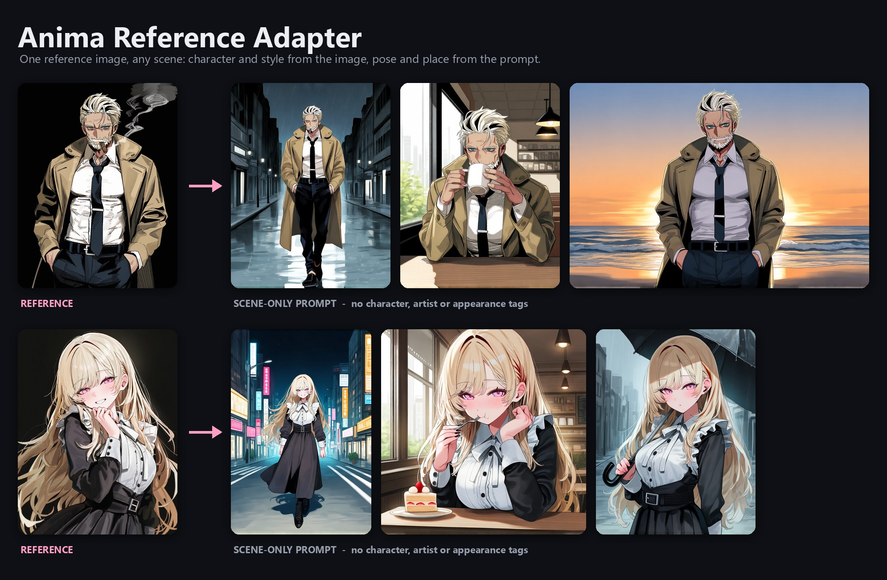
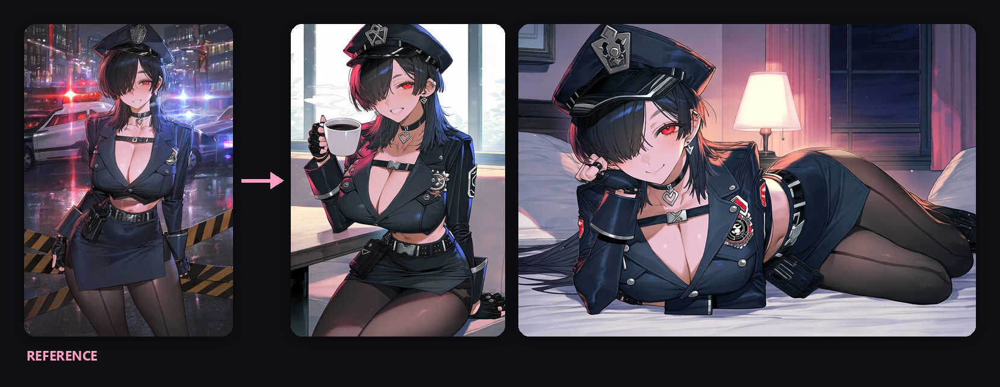
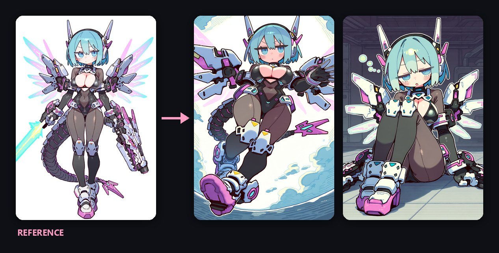
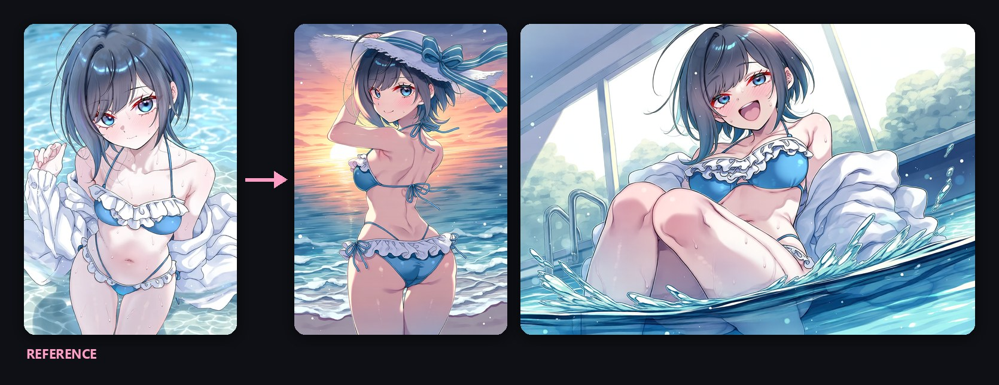
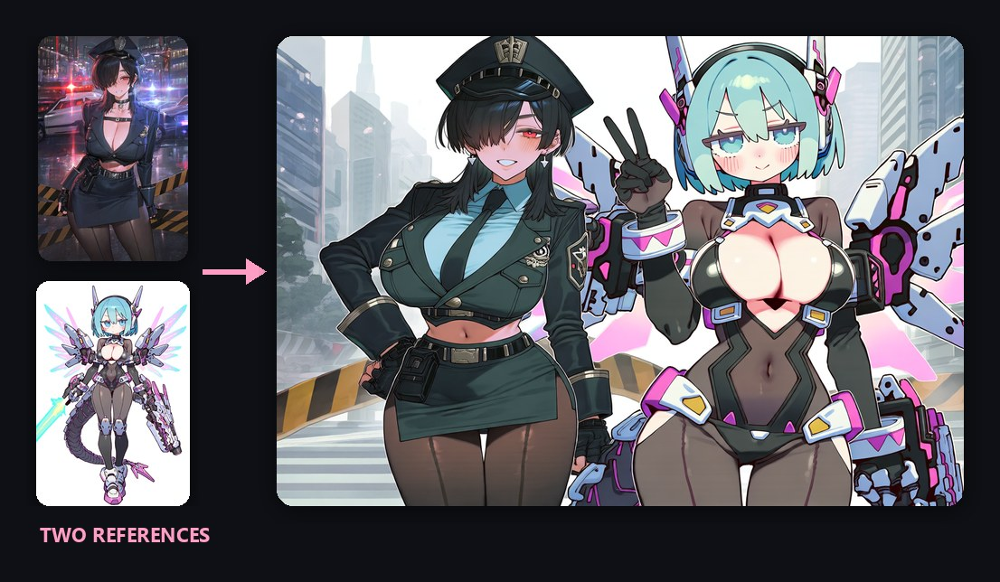
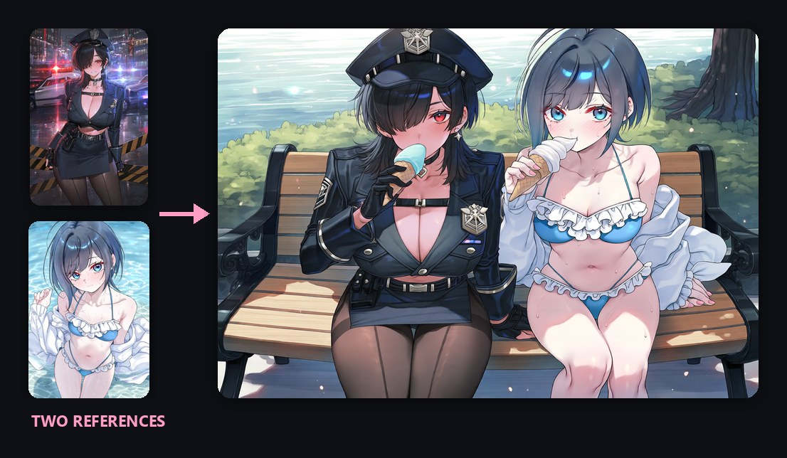
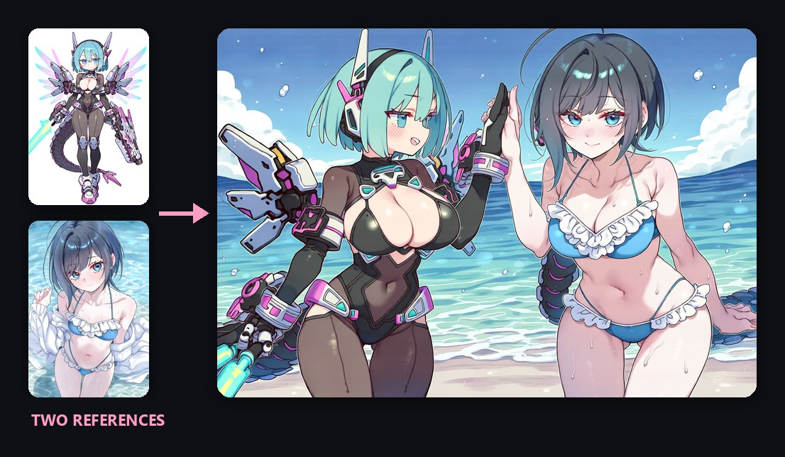
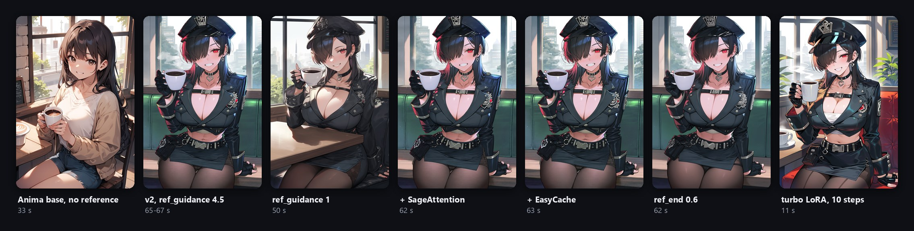
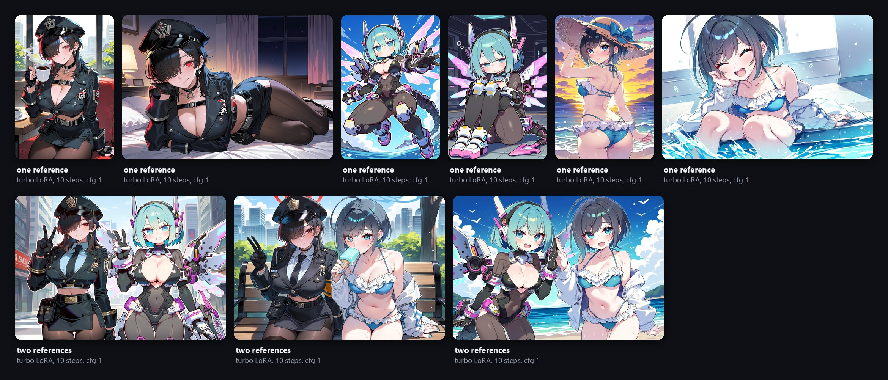

<div align="center">



# Anima Reference Adapter for ComfyUI

**参照画像からキャラクターと画風を、プロンプトからポーズ・場所・構図を。**

[](https://huggingface.co/ElectronGirl/anima-ref-adapter)
[](https://github.com/ArcAnima/ComfyUI-Anima-Ref-Adapter)
[](https://github.com/ElectronGirl/anima-ref-adapter-research)

[ショーケース](#ショーケース) · [クイックスタート](#クイックスタート) · [使い方ガイド](docs/guide.ja.md) · [速度](#速度と互換性) · [学習コード](https://github.com/ElectronGirl/anima-ref-adapter-research)

[English](README.md) · [한국어](README.ko.md) · **日本語**

</div>

<br>

[Anima](https://huggingface.co/circlestone-labs/Anima) に参照画像1枚と、シーンだけを書いたプロンプトを渡すと、
アダプターは**誰を**描くか（髪、目、衣装、アクセサリー）と、**どう**描くかの多くを参照画像から取り込みます。
**ポーズ、背景、構図はプロンプトに従います。** キャラクター名や絵師・衣装のタグは不要なので、オリジナル
キャラクターにも使えます。参照画像を2枚並べれば、2人のキャラクターを1枚に描けます。

> [!NOTE]
> **資金不足のため開発を休止しています。** 現在は追加の学習ができず、予定していたキャラクターと画風を
> 別々に指定する参照機能は公開できていません。学習コード、データ生成コード、実験記録は
> **[anima-ref-adapter-research](https://github.com/ElectronGirl/anima-ref-adapter-research)** で公開しています。

## v2 の新機能

| | |
|---|---|
| ⚡ **パイロット版の約2倍の速さ** | RTX PRO 6000 ではサンプリング1ステップあたり 2.1 倍速くなりました。RTX 3060 Ti では 832x1216 の画像1枚が 105 秒から 65 秒になり、参照画像による追加時間は 72 秒から 32 秒に減りました。参照画像の KV を毎ステップ計算し直さず、画像ごとに1回だけ計算してキャッシュします。 |
| 🧩 **ノード1つ** | **Anima Ref Adapter** ノードを Anima の標準ワークフローに1つ加えるだけで、KSampler をはじめどのサンプラーでも動きます。重みは初回実行時に自動でダウンロードされます。 |
| 👥 **2人のキャラクター** | 参照画像を2枚並べ、プロンプトにどちらが誰かを書くだけです。 |
| 📚 **より多くの学習データ** | キャラクター 2,300 人、絵師の画風 1,952 種、画像 15,600 枚で学習しました（パイロット版: 画像 3,600 枚、キャラクター 300 人）。rank 64 です。 |

## ショーケース

[ノード1つのワークフロー](workflows/anima_ref_adapter.json) を Anima の標準設定で実行した結果です: er_sde、30 steps、
cfg 4.5、`ref_guidance` 4.5 + APG、プロンプトは `masterpiece, best quality, score_7, safe, 1girl, solo, <シーン>`、ネガティブプロンプトは Anima の
モデルカードのものです。ほかの LoRA は使っていません。各画像はシード1つだけで、選別していません。ただし
横になったポーズだけは6枚の中から最も良いものを選びました。

### 参照画像1枚


<sub><code>cowboy shot, sitting, cafe, holding cup, coffee, smile, looking at viewer, indoors, window, day</code> &nbsp;·&nbsp; <code>full body, lying, on side, on bed, head rest, looking at viewer, smile, bedroom, indoors, night, lamp light</code></sub>


<sub><code>full body, flying, from below, sky, clouds, sunlight, dynamic pose, outstretched arm</code> &nbsp;·&nbsp; <code>sitting, on floor, hugging own legs, sleepy, hangar, indoors, dim lighting</code></sub>


<sub><code>cowboy shot, beach, ocean, sunset, wind, hand on own hat, sun hat, smile, looking back</code> &nbsp;·&nbsp; <code>upper body, sitting, poolside, legs in water, splashing, laughing, day</code></sub>

### 2人のキャラクター

参照画像2枚を1枚に横並びでつなぎ（標準の **Image Stitch** ノード）、左と右がそれぞれ誰かを短く書きます。
`solo` の代わりに `2girls` や `1boy, 1girl` を使い、横長のサイズにします。[ワークフロー](workflows/anima_ref_adapter_two_characters.json)。


<sub><code>2girls, the girl on the left is a policewoman with black hair over one eye, the girl on the right is a mecha girl with aqua hair and mechanical wings, standing side by side, peace sign, smile, city, street, day</code></sub>


<sub><code>2girls, the girl on the left is a policewoman with black hair over one eye, the girl on the right is a girl with short black hair in a blue frilled bikini, sitting together on a bench, eating ice cream, park, day</code></sub>


<sub><code>2girls, the girl on the left is a mecha girl with aqua hair and mechanical wings, the girl on the right is a girl with short black hair in a blue frilled bikini, high five, beach, ocean, day</code></sub>

## クイックスタート

```bash
cd ComfyUI/custom_nodes
git clone https://github.com/ArcAnima/ComfyUI-Anima-Ref-Adapter.git
```

1. Anima base v1.0、Qwen3-0.6B テキストエンコーダー、Qwen-Image VAE を
   [circlestone-labs/Anima](https://huggingface.co/circlestone-labs/Anima) から入手します。Anima を使うときと同じです。
2. ComfyUI を再起動し、[`workflows/anima_ref_adapter.json`](workflows/anima_ref_adapter.json) を開きます。Anima の
   text-to-image ワークフローにノードを1つ加えたもので、ほかのカスタムノードは不要です。
3. 参照画像を読み込み、シーンだけを書いたプロンプトを入力して実行します。初回は `anima_ref_adapter_v2_r64.safetensors`（183MB）を
   [Hugging Face](https://huggingface.co/ElectronGirl/anima-ref-adapter) から `ComfyUI/models/loras/` にダウンロードします。手動で入れる場合は
   [このファイル](https://huggingface.co/ElectronGirl/anima-ref-adapter/blob/main/anima_ref_adapter_v2_r64.safetensors) を同じフォルダに置いてください。

**自作のワークフローでは**、**Anima Ref Adapter** をモデル（ほかの LoRA の後）とサンプラーの間に置き、VAE と
参照画像をつなぎます。

プロンプトの書き方、設定、トラブルシューティングまで順に説明した **[使い方ガイド](docs/guide.ja.md)** があります。

## 速度と互換性

RTX 3060 Ti 8GB（fp16）、832x1216、参照画像1枚、2回測った速いほう:

| 設定 | 画像1枚 |
|---|---|
| Anima base、er_sde 30 steps、cfg 4.5、**参照画像なし** | 33 秒 |
| + パイロット版アダプター、`ref_guidance` 4.5 | 105 秒 |
| **+ v2 アダプター**、`ref_guidance` 4.5 | **65-67** 秒 |
| `ref_guidance` 1（追加のモデル呼び出しなし） | 50 秒 |
| + SageAttention（[KJNodes](https://github.com/kijai/ComfyUI-KJNodes) Patch Sage Attention） | 62 秒 |
| + EasyCache（標準ノード） | 63 秒 |
| `ref_end` 0.6 | 62 秒 |
| **turbo LoRA**（strength 1）、10 steps、cfg 1、`ref_guidance` 1 | **11** 秒 |



- SageAttention、EasyCache、`ref_end` 0.6 は、この GPU でそれぞれ約7%速くなり、画像はほぼ同じです。
- Anima base 用の **turbo LoRA**（検証したファイル: `anima-turbo-lora-v0.2`）はアダプターの前に置きます。キャラクターは
  保たれますが、絵が turbo 特有の画風に寄るため、参照画像の画風は反映されにくくなります。
- 未検証: Anima-Turbo・Anima-Aesthetic の完全なモデル、SamplerSPEED、torch.compile。

<details>
<summary>turbo LoRA で作ったショーケース全体（10 steps、cfg 1）</summary>



</details>

## 推奨設定

|  | 推奨値 | 説明 |
|---|---|---|
| ベースモデル | Anima base v1.0 | アダプターはこのモデルで学習しました。turbo LoRA も動作します。 |
| サンプラー | 何でも可。er_sde か Euler、30 steps、`simple` | アダプターなしで Anima を使うときと同じです。 |
| `cfg` | 4.5 | テキストのガイダンスです。turbo LoRA を使うときは 1 です。 |
| `ref_guidance` | 4.5 | 1 は速いが弱く、高いほどキャラクターの細部と画風が強くなり、彩度も上がります。 |
| `correction` | `apg` | または `rescale` |
| `ref_end` | 1.0 | 0.6 前後でほぼ同じ画像をより速く得られます。 |
| プロンプト | 品質 + `1girl`/`1boy` + `solo` + シーンのタグ | キャラクター名、絵師タグ、外見のタグは入れません。外見のタグが少しなら問題ありません。 |
| ほかの LoRA | アダプターノードの前 |  |

## 仕組み

参照画像のトークンは自分自身だけを見てテキストの cross-attention を飛ばし、生成中の画像のトークンは自分自身と
参照画像の両方を見るように学習しています（非対称 attention）。そのため参照画像側の計算はステップ、プロンプト、
CFG の分岐に依存せず、ブロックごとの key/value を画像1枚につき1回だけ計算して再利用します。参照画像は生成画像の
格子の外側にずらした RoPE 座標に置かれるため、ポーズをそのまま写さず、外見として読み取られます。詳しくは
[English README](README.md#how-it-works) と [技術レポート](docs/report.md)（パイロット版）をご覧ください。

## パイロット版（v1）

パイロット版（`anima_ref_adapter_pilot_r32.safetensors`、rank 32）も引き続きダウンロードでき、
[advanced ワークフロー](workflows/anima_ref_adapter_advanced.json) で使えます。パイロット版のギャラリーと、学習から除外した
キャラクターの結果は [English README](README.md#pilot-v1) にあります。

## 制限

- キャラクターは画風よりずっとよく再現されます。筆致の強い画風はほとんど再現されません。
- 小さな模様、傷、イヤリング、珍しい肌の色は抜けやすく、大きな衣装は色が変わることがあります。
- 参照キャラクターがシーンの中に物（ポスターなど）として再登場することがあります。
- Anima が生成した画像だけで学習しているため、ベースモデルの偏りをそのまま受け継いでいます。

## ロードマップ

| | |
|---|---|
| 参照画像1枚からキャラクターと画風 | ✅ パイロット版、v2 |
| 参照画像をキャッシュする非対称 attention | ✅ v2 |
| 参照画像2枚を並べて2人のキャラクター | ✅ v2 |
| キャラクターと画風を別々に指定する参照 | ⏸️ 休止（実験のみ） |
| 高解像度での学習、筆致の強い画風と細部の改善 | ⏸️ 休止 |

## ライセンス

ノードのコードは **Apache-2.0**（[LICENSE](LICENSE)）です。アダプターの重みは CircleStone Model の派生物で、
Hugging Face で **CircleStone Non-Commercial License** のもとで配布しています。このプロジェクトは CircleStone Labs と
関係がなく、CircleStone Labs の保証を受けていません。
