<div align="center">


# Anima Reference Adapter for ComfyUI

**Character and style from one image. Pose, place and framing from your prompt.**

[](https://huggingface.co/ElectronGirl/anima-ref-adapter)
[](https://github.com/ElectronGirl/ComfyUI-Anima-Ref-Adapter)
[](https://github.com/ElectronGirl/ComfyUI-Anima-Ref-Adapter/blob/main/docs/report.md)
[](https://github.com/ElectronGirl/ComfyUI-Anima-Ref-Adapter/blob/main/LICENSE)
[](https://huggingface.co/ElectronGirl/anima-ref-adapter/blob/main/LICENSE.md)

</div>

<br>

Give [Anima](https://huggingface.co/circlestone-labs/Anima) a single reference image and a prompt that only
describes the scene. The adapter keeps **who** is drawn (hair, eyes, outfit, accessories) and some of **how**
it is drawn, while **pose, background and composition follow the prompt**. No character name, artist tag
or appearance tags needed, so it also works for original characters. Two characters work too: put their
images side by side and say in the prompt who is on which side.

> [!IMPORTANT]
> **Development is paused for lack of funding.** Further training is not possible for now, and the planned
> separate character and style references are not released. The training code, data generation and experiment log are public in
> **[ElectronGirl/anima-ref-adapter-research](https://github.com/ElectronGirl/anima-ref-adapter-research)**.

## What's new in v2

- **1.6x faster than the pilot.** 65 s instead of 105 s per image on an RTX 3060 Ti (832x1216, 30 steps,
  same settings; 33 s without a reference), and 2.1x faster per sampling step on an RTX PRO 6000. The
  reference is encoded once per image instead of being recomputed at every step
  ([details](#v2-rank-64-asymmetric-attention)).
- **More training data**: 15,600 images of 2,300 characters in 1,952 artist styles (the pilot: 3,600 images,
  300 characters), at rank 64.
- **One node**: Anima Ref Adapter drops into the standard Anima workflow and works with KSampler and any
  sampler; the weights download on first use.
- **Two characters** from two references side by side.

## Gallery (v2)

The [one-node workflow](workflows/anima_ref_adapter.json) with Anima's default settings: er_sde, 30 steps, cfg 4.5,
`ref_guidance` 4.5 + APG; prompt `masterpiece, best quality, score_7, safe, 1girl, solo, <scene>` and the
negative prompt from the Anima model card. No other LoRAs. One seed per image, not cherry-picked.

<table>
<tr><td align="center" valign="middle" width="25%">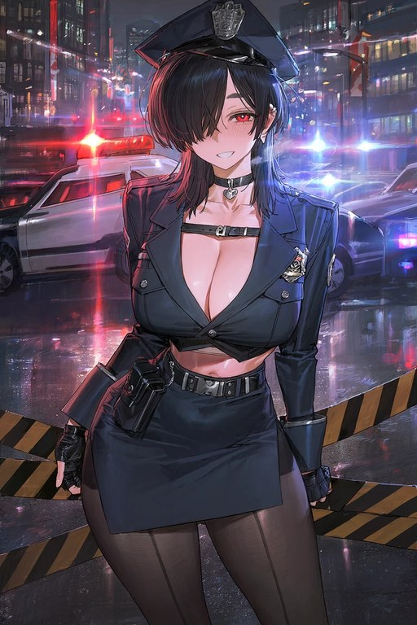<br><b>reference</b></td><td align="center" valign="top" width="25%">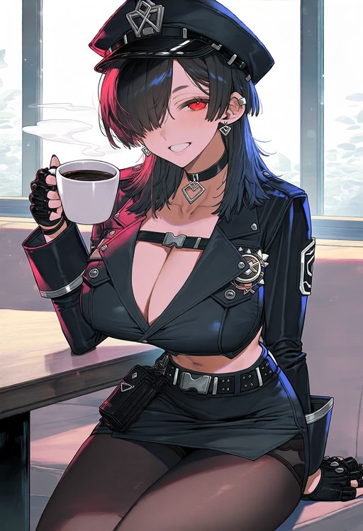<br><sub><code>cowboy shot, sitting, cafe, holding cup, coffee, smile, looking at viewer, indoors, window, day</code></sub></td><td align="center" valign="top" width="50%">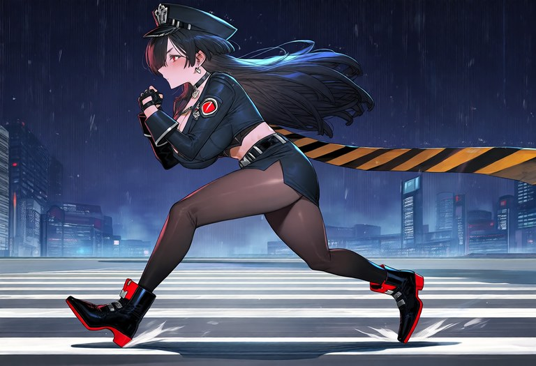<br><sub><code>full body, running, motion blur, from side, determined, city, street, night, rain</code></sub></td></tr>
<tr><td align="center" valign="middle" width="25%">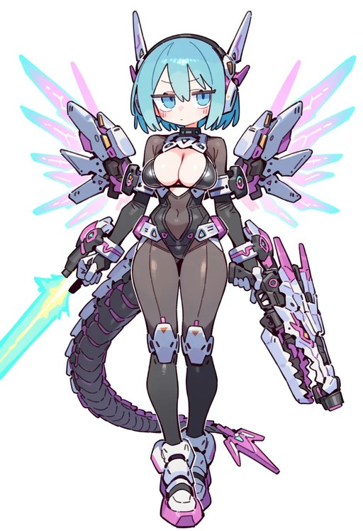<br><b>reference</b></td><td align="center" valign="top" width="25%">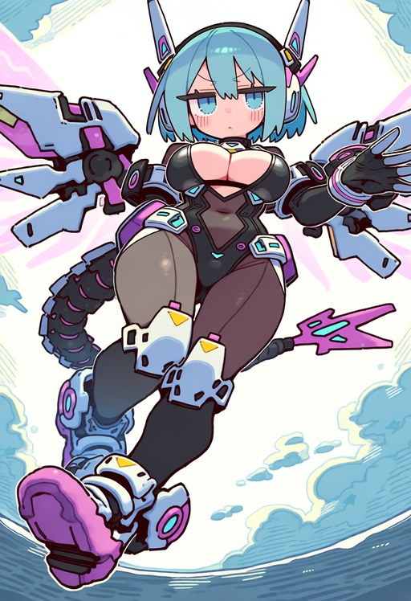<br><sub><code>full body, flying, from below, sky, clouds, sunlight, dynamic pose, outstretched arm</code></sub></td><td align="center" valign="top" width="25%">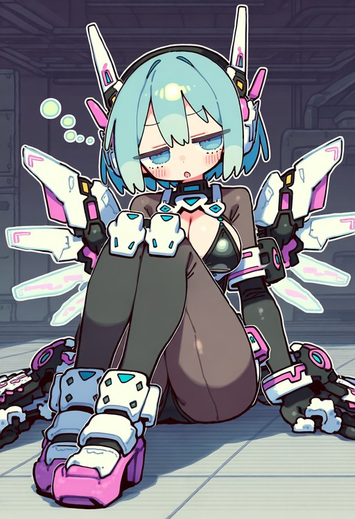<br><sub><code>sitting, on floor, hugging own legs, sleepy, hangar, indoors, dim lighting</code></sub></td><td></td></tr>
<tr><td align="center" valign="middle" width="25%">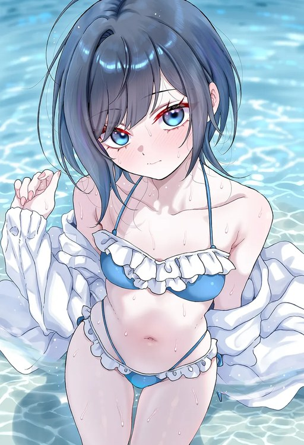<br><b>reference</b></td><td align="center" valign="top" width="25%">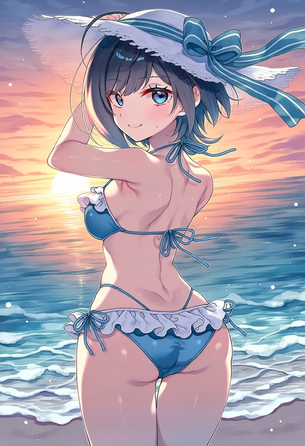<br><sub><code>cowboy shot, beach, ocean, sunset, wind, hand on own hat, sun hat, smile, looking back</code></sub></td><td align="center" valign="top" width="50%">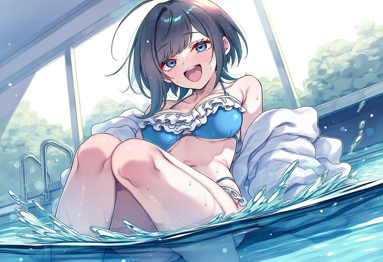<br><sub><code>upper body, sitting, poolside, legs in water, splashing, laughing, day</code></sub></td></tr>
</table>

### Two characters

Put the two references side by side in one image (core **Image Stitch** node) and write in the prompt who
is on the left and who is on the right, with a few words each. Use `2girls` or `1boy, 1girl` instead of
`solo`, and a landscape output. [Workflow](workflows/anima_ref_adapter_two_characters.json).

<table>
<tr><td align="center" valign="middle" width="40%">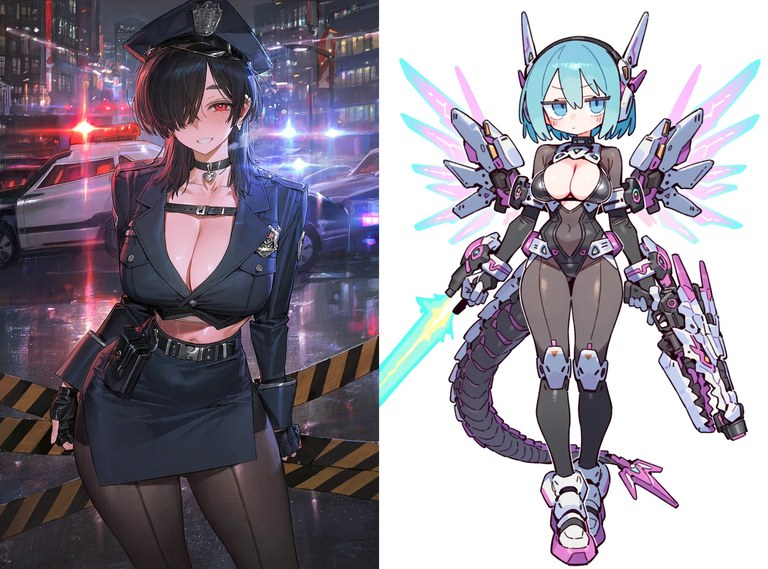<br><b>reference: two images side by side</b></td><td align="center" valign="top" width="60%">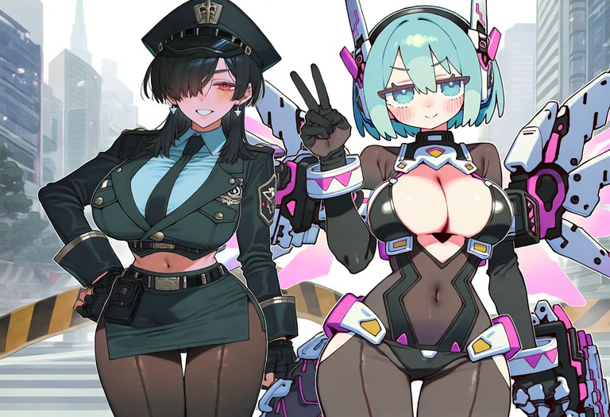<br><sub><code>2girls, the girl on the left is a policewoman with black hair over one eye, the girl on the right is a mecha girl with aqua hair and mechanical wings, standing side by side, peace sign, smile, city, street, day</code></sub></td></tr>
<tr><td align="center" valign="middle" width="40%">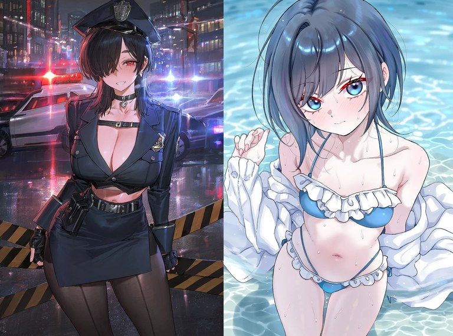<br><b>reference: two images side by side</b></td><td align="center" valign="top" width="60%">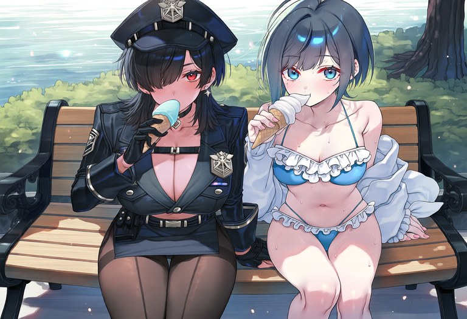<br><sub><code>2girls, the girl on the left is a policewoman with black hair over one eye, the girl on the right is a girl with short black hair in a blue frilled bikini, sitting together on a bench, eating ice cream, park, day</code></sub></td></tr>
<tr><td align="center" valign="middle" width="40%">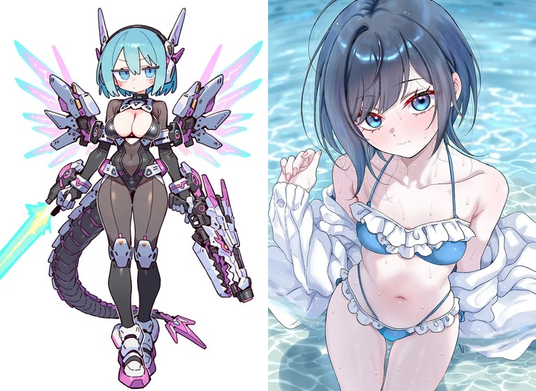<br><b>reference: two images side by side</b></td><td align="center" valign="top" width="60%">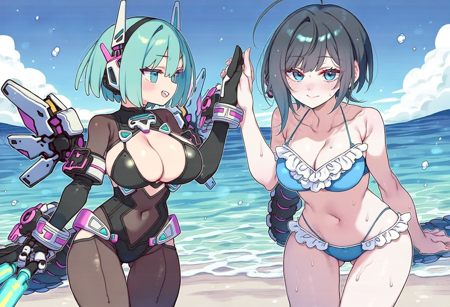<br><sub><code>2girls, the girl on the left is a mecha girl with aqua hair and mechanical wings, the girl on the right is a girl with short black hair in a blue frilled bikini, high five, beach, ocean, day</code></sub></td></tr>
</table>

## Quick start

```bash
cd ComfyUI/custom_nodes
git clone https://github.com/ElectronGirl/ComfyUI-Anima-Ref-Adapter.git
```

1. The adapter weights download by themselves: the first run with `anima_ref_adapter_v2_r64.safetensors`
   selected fetches it from [ElectronGirl/anima-ref-adapter](https://huggingface.co/ElectronGirl/anima-ref-adapter) into `ComfyUI/models/loras/` (183 MB). To install
   it by hand, [download it](https://huggingface.co/ElectronGirl/anima-ref-adapter/blob/main/anima_ref_adapter_v2_r64.safetensors) into the same folder.
2. Anima base v1.0, the Qwen3-0.6B text encoder and the Qwen-Image VAE come from
   [circlestone-labs/Anima](https://huggingface.co/circlestone-labs/Anima).
3. Restart ComfyUI and open `workflows/anima_ref_adapter.json`. It is the Anima text-to-image workflow with
   one extra node and needs no other custom nodes.
4. Load a reference image, write a prompt that describes only the scene, queue.

To add the adapter to your own workflow, put **Anima Ref Adapter** between the model (after any other
LoRAs) and the sampler, and connect the VAE and the reference image. It works with the stock **KSampler**
and any other sampler or guider.

## Speed and compatibility

RTX 3060 Ti 8 GB (fp16), 832x1216, one reference; the faster of two runs:

| setup | time per image |
|---|---|
| Anima base, er_sde 30 steps, cfg 4.5, **no reference** | 33 s |
| + pilot adapter, `ref_guidance` 4.5 | 105 s |
| **+ v2 adapter**, `ref_guidance` 4.5 | **65-67 s** |
| `ref_guidance` 1 (no extra model call) | 50 s |
| + SageAttention ([KJNodes](https://github.com/kijai/ComfyUI-KJNodes) Patch Sage Attention) | 62 s |
| + EasyCache (core) | 63 s |
| `ref_end` 0.6 | 62 s |
| **turbo LoRA** (strength 1), 10 steps, cfg 1, `ref_guidance` 1 | **11 s** |


- SageAttention, EasyCache and `ref_end` 0.6 each save about 7% on this GPU and give nearly the same image.
- A **turbo LoRA** for Anima base (tested: `anima-turbo-lora-v0.2`) goes in front of the adapter. It keeps
  the characters but pulls the drawing toward its own look, so less of the reference style comes through.
  [The whole gallery with the turbo LoRA](docs/figures/v2_turbo.jpg).
- Not tested: the Anima-Turbo and Anima-Aesthetic full models, SamplerSPEED (its half-resolution stage
  was unreliable with the pilot), torch.compile.

## Nodes

| node | |
|---|---|
| **Anima Ref Adapter** | The one to use. `MODEL` + `VAE` + reference `IMAGE` + adapter LoRA -> `MODEL` for any sampler. The released adapter files are listed even before download and fetched on first use. The reference is resized to `ref_megapixels` (1.0) keeping its aspect ratio. `ref_guidance` runs as a post-CFG patch, one extra model call per step when it is not 1; `ref_end` stops that call early. |
| Anima Ref Adapter Loader, Anima Ref Latent, Anima Ref Guider | The separate nodes, for the pilot adapter (it needs the reference at the output size) and the extra guider options `ref_start` and `outside`. [Workflow](workflows/anima_ref_adapter_advanced.json). |

## Recommended settings

| | recommended | notes |
|---|---|---|
| base model | Anima base v1.0 | the adapter was trained on it; a turbo LoRA also works (see above) |
| sampler | any; er_sde or Euler, 30 steps, `simple` | as for Anima without the adapter |
| `cfg` | 4.5 | text guidance; 1 with a turbo LoRA |
| `ref_guidance` | 4.5 | 1 = cheaper and weaker; higher = more character detail and style, more saturation |
| `correction` | `apg` | or `rescale` (phi 0.5) |
| `ref_end` | 1.0 | ~0.6 is faster with nearly the same image |
| prompt | quality + `1girl` / `1boy` + `solo` + scene tags | no character name, artist tag or appearance tags; a few appearance tags are fine |
| other LoRAs | in front of the adapter node | |

## v2: rank 64, asymmetric attention

- **Asymmetric attention.** Target tokens attend to themselves and the reference; reference tokens attend
  only to themselves and skip the text cross-attention. The reference therefore does not depend on the step,
  the prompt or the target, so its keys and values are computed once per generation and reused by every
  step and both CFG branches. The reference may also have a different size than the output.
- **Larger, more varied data.** 15,600 images generated by Anima: 2,300 characters drawn in 1,952 artist
  styles (6,600 character x style groups), targets at 0.56-1 MP.
- **Rank 64** (the pilot is rank 32).

| 832x1216, RTX PRO 6000, CFG | pilot (two-frame) | v2 (asymmetric) | no reference |
|---|---|---|---|
| one sampling step | 0.58 s | 0.28 s (+ 0.1 s once to encode the reference) | 0.24 s |

v2 needs the nodes from version 0.2.0 or later. The pilot (`anima_ref_adapter_pilot_r32.safetensors`) stays
available.

## Gallery (pilot)

Every image below used the prompt `masterpiece, best quality, score_7, newest, highres, absurdres, safe, <gender>, solo, <scene>` with the scene tags shown, the
reference image on the left, and Euler 28 steps, cfg 4.5, reference guidance 4.5 + APG, context detailer LoRA 0.3, base slider LoRA 0.6, Anima Safe PAG (block 18, scale 1.3, 0.2-0.9). Seeds were not cherry-picked.

<table>
<tr><td rowspan="2" align="center" valign="middle" width="25%">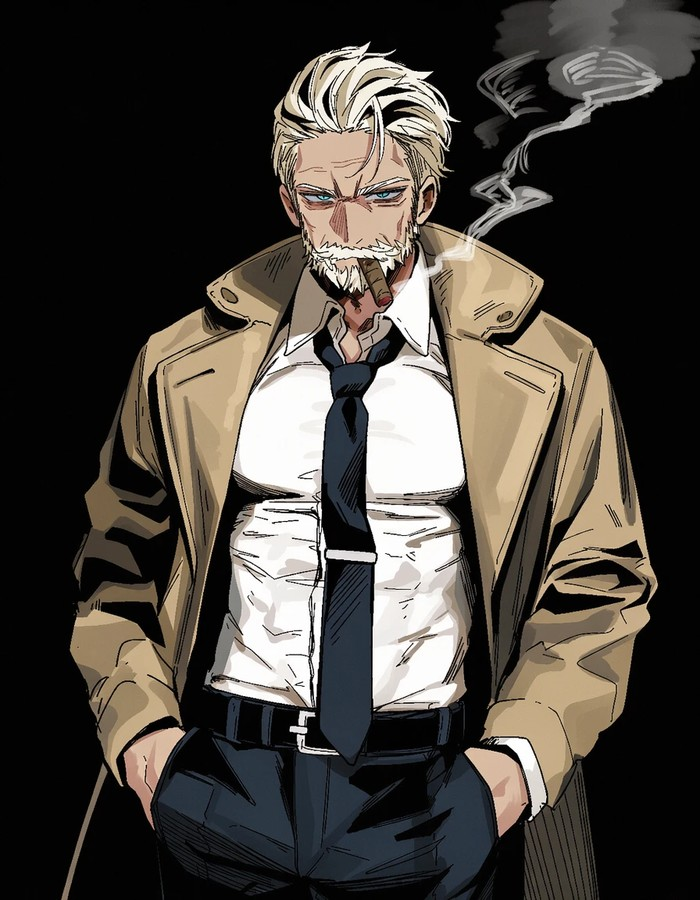<br><b>Reference A</b><br><sub>input image</sub></td><td align="center" valign="top" width="25%">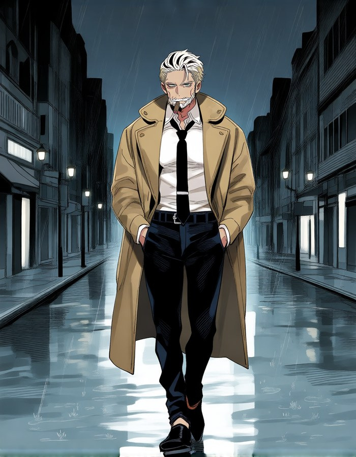<br><sub><code>full body, walking, hands in pockets, city, street, night, rain</code></sub></td><td align="center" valign="top" width="25%">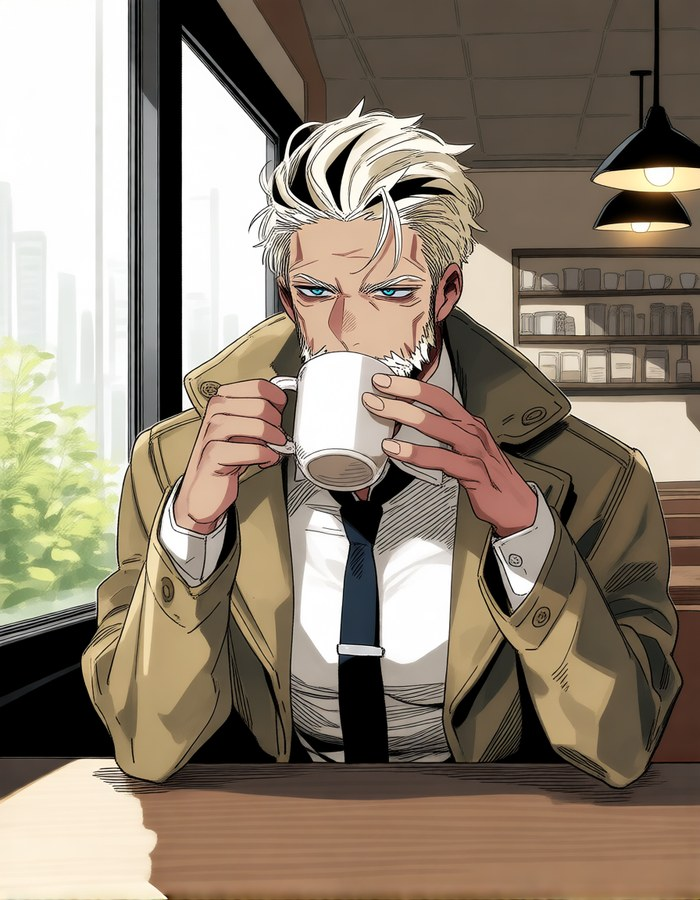<br><sub><code>upper body, sitting, holding cup, drinking, cafe, indoors, window, sunlight</code></sub></td><td align="center" valign="top" width="25%">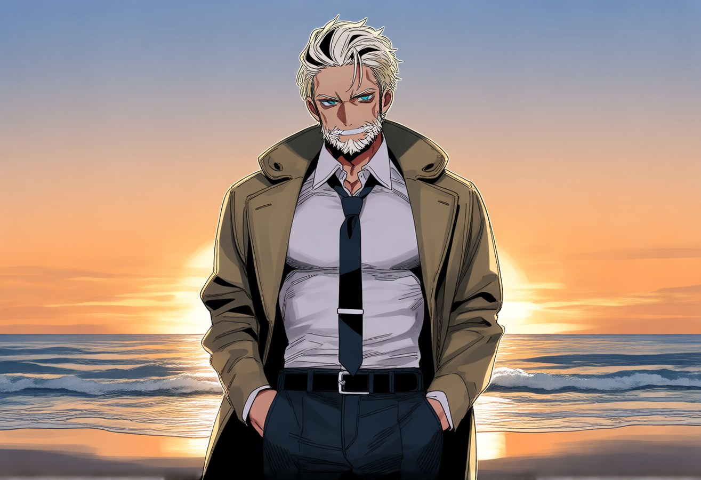<br><sub><code>cowboy shot, looking at viewer, smile, beach, ocean, sunset</code></sub></td></tr>
<tr><td align="center" valign="top" width="25%">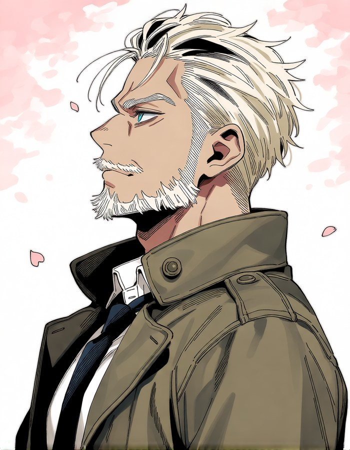<br><sub><code>portrait, from side, looking afar, cherry blossoms, petals</code></sub></td><td align="center" valign="top" width="25%"><br><sub><code>upper body, reading, holding book, library, bookshelf</code></sub></td><td align="center" valign="top" width="25%">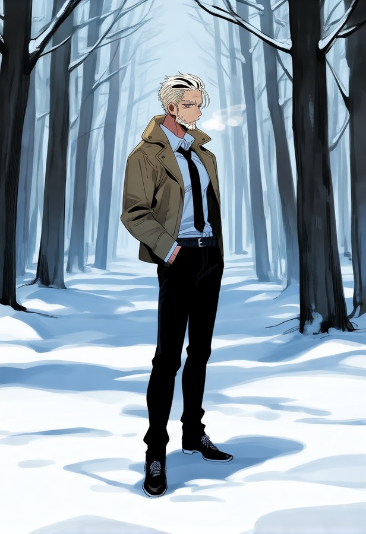<br><sub><code>full body, standing, snow, forest, winter</code></sub></td></tr>
</table>

<table>
<tr><td rowspan="2" align="center" valign="middle" width="25%">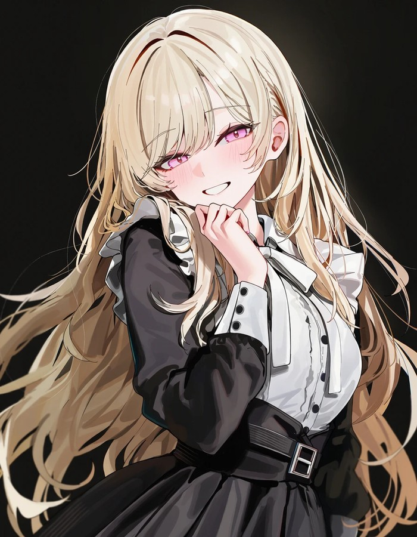<br><b>Reference B</b><br><sub>input image</sub></td><td align="center" valign="top" width="25%">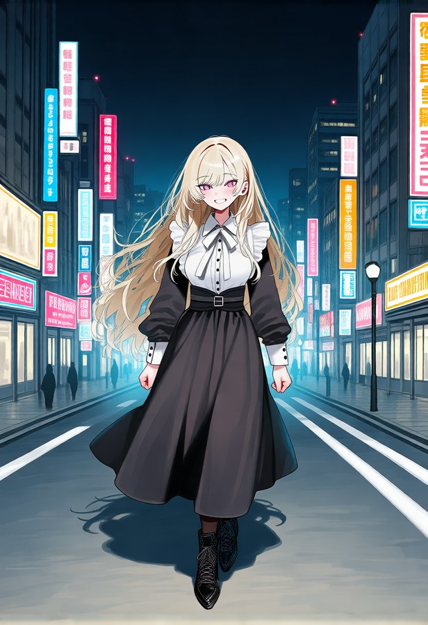<br><sub><code>full body, walking, smile, city, street, night, neon lights</code></sub></td><td align="center" valign="top" width="25%">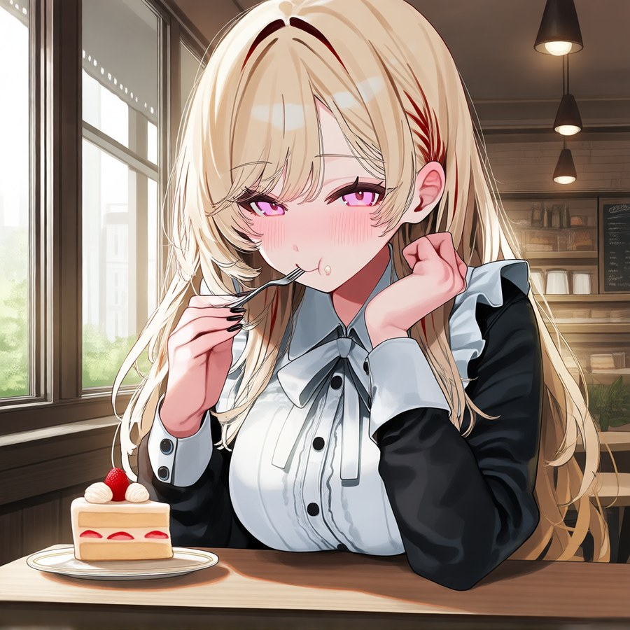<br><sub><code>upper body, sitting, eating, cake, cafe, indoors</code></sub></td><td align="center" valign="top" width="25%">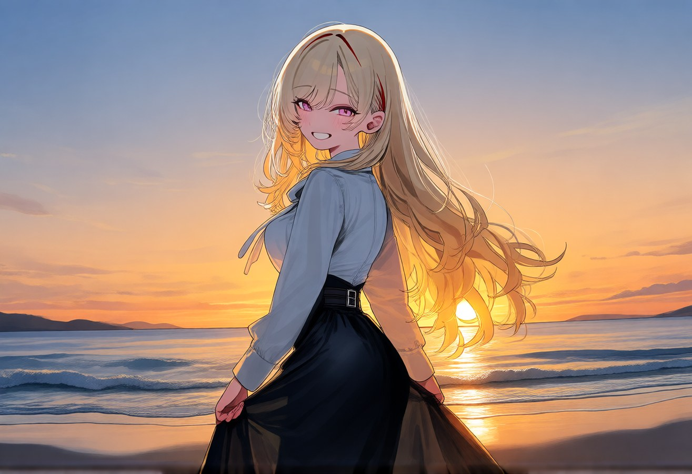<br><sub><code>cowboy shot, looking back, smile, beach, ocean, sunset</code></sub></td></tr>
<tr><td align="center" valign="top" width="25%">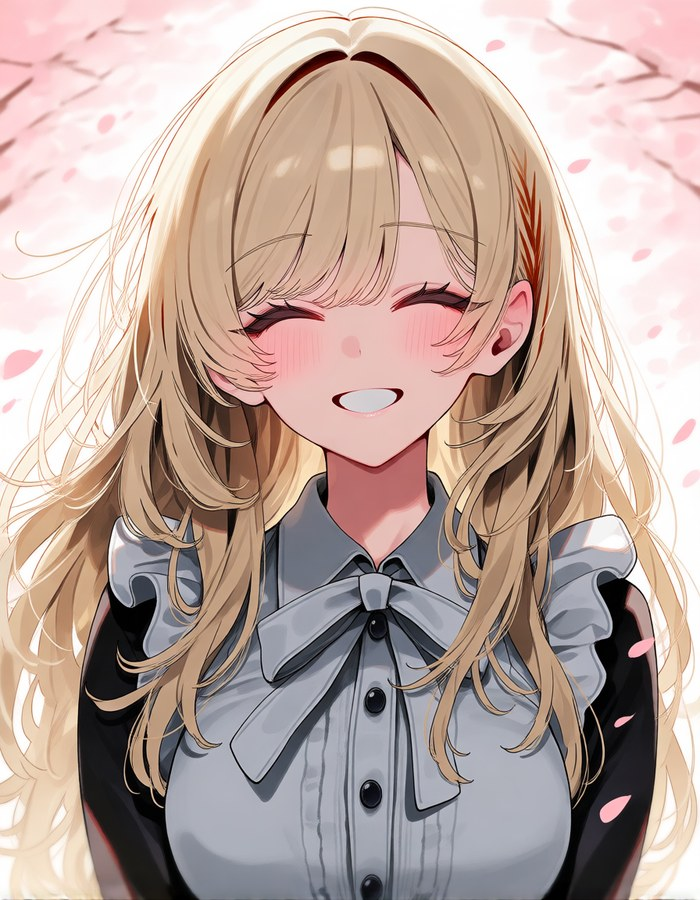<br><sub><code>portrait, closed eyes, smile, cherry blossoms, petals, wind</code></sub></td><td align="center" valign="top" width="25%">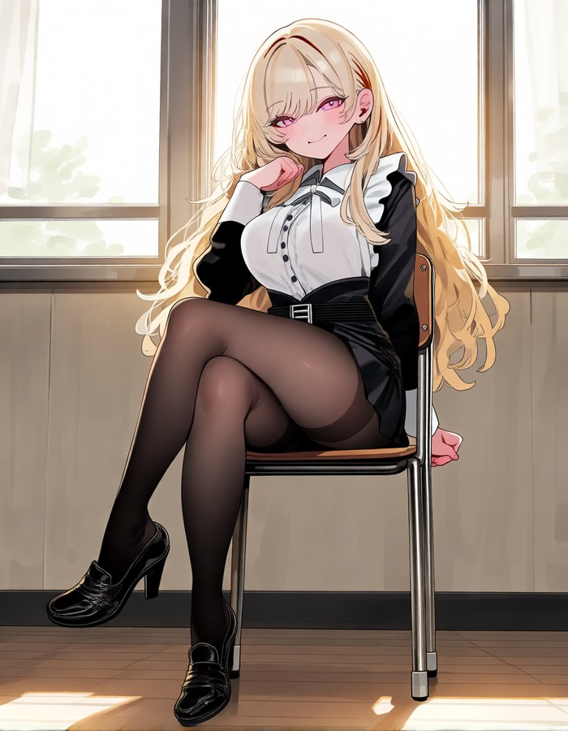<br><sub><code>full body, sitting, on chair, crossed legs, classroom, sunlight</code></sub></td><td align="center" valign="top" width="25%">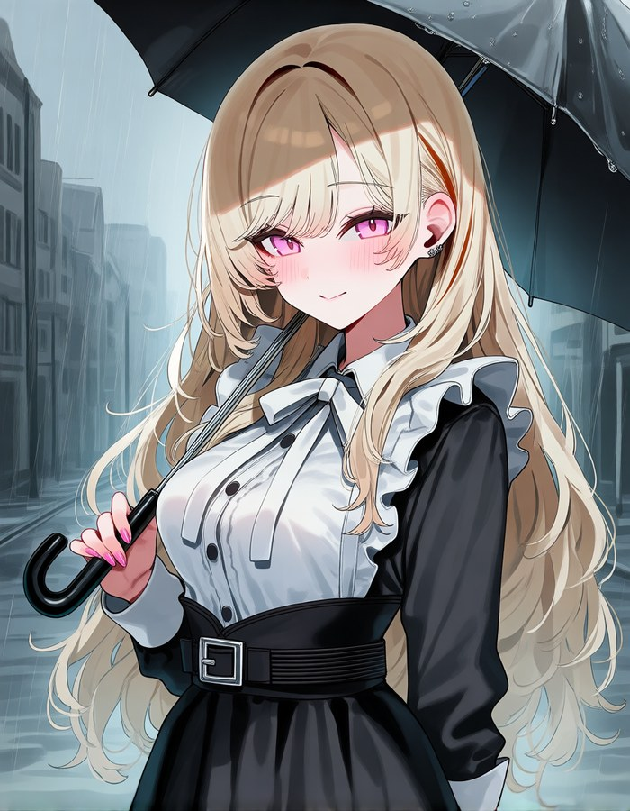<br><sub><code>upper body, holding umbrella, rain, street, looking at viewer</code></sub></td></tr>
</table>

### Unseen characters

These characters were **excluded from training**. Each row: the reference image, the adapter's
result for a different scene, the same scene-only prompt without the adapter (a generic character), and
what the base model draws when the prompt also names the character with its appearance tags.


<details>
<summary>Scene prompts used in this figure</summary>

| character | scene tags |
|---|---|
| Tohru | `full body, looking at viewer, heart hands, crying, simple background, white background` |
| Eternity Larva | `full body, looking at viewer, against wall, closed eyes, gradient background, sunlight` |
| Meiko | `portrait, from side, writing, crying, beach, ocean, light rays` |
| Crocodile | `upper body, from below, drinking, sad, bookshelf, indoors` |

</details>

## How it works

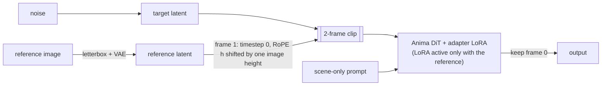

- The reference becomes a **second latent frame**, fed **clean** (timestep 0).
- Its **RoPE coordinates are shifted** past the target grid, so the model cannot copy it pixel-aligned:
  no pose copying, unlike an aligned temporal reference.
- A **rank-32 LoRA** (45.9M parameters) learns to read that frame. It was trained on pairs of the same
  character in different scenes generated by Anima, with the character's name, artist and appearance
  tags removed from the target prompt.
- **Separate text and reference guidance** with adaptive projected guidance (APG) keeps colors under
  control at high reference guidance.

v2 replaces the joint frame with asymmetric attention and a cached reference (see [v2](#v2-rank-64-asymmetric-attention)).

Details, data and failure modes of the pilot: **[technical report](docs/report.md)**.

<details>
<summary><b>Limitations</b></summary>

- The pilot was trained on only 300 characters.
- Identity transfers much better than style; strongly painterly styles barely transfer.
- Small patterns, scars, earrings and unusual skin tones are often lost; large garments can drift in color.
- The reference character occasionally reappears as an object in the scene.
- Trained only on images generated by Anima; it inherits the base model's biases.

</details>

## Roadmap

| | status |
|---|---|
| Single reference: character + style from one image | **available**: pilot and v2 |
| Asymmetric attention with a cached reference (about 2x faster sampling steps) | **available** (v2) |
| Two characters from two references side by side | **available** (v2) |
| Separate character and style references | **paused** (experiments only, not released) |
| Higher-resolution training, better transfer of painterly styles and fine details | **paused** |

Development is paused for lack of funding. The training code is public:
[ElectronGirl/anima-ref-adapter-research](https://github.com/ElectronGirl/anima-ref-adapter-research).

## License

The node code is **Apache-2.0** ([LICENSE](LICENSE)). The adapter weights are a derivative of the
CircleStone Model and are distributed on Hugging Face under the **CircleStone Non-Commercial License**.
This project is not affiliated with or endorsed by CircleStone Labs.

## Citation

```bibtex
@misc{anima_ref_adapter_2026,
  title  = {Anima Reference Adapter: Single-Image Character and Style Transfer with an Offset-RoPE Reference Frame},
  author = {ElectronGirl},
  year   = {2026},
  url    = {https://github.com/ElectronGirl/ComfyUI-Anima-Ref-Adapter}
}
```
