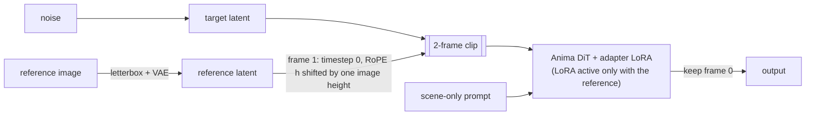

<div align="center">


# Anima Reference Adapter for ComfyUI

**Character and style from one image. Pose, place and framing from your prompt.**

[](https://huggingface.co/ElectronGirl/anima-ref-adapter)
[](https://github.com/ElectronGirl/ComfyUI-Anima-Ref-Adapter)
[](https://github.com/ElectronGirl/ComfyUI-Anima-Ref-Adapter/blob/main/docs/report.md)
[](https://github.com/ElectronGirl/ComfyUI-Anima-Ref-Adapter/blob/main/LICENSE)
[](https://huggingface.co/ElectronGirl/anima-ref-adapter/blob/main/LICENSE.md)

</div>

<br>

Give [Anima](https://huggingface.co/circlestone-labs/Anima) a single reference image and a prompt that only
describes the scene. The adapter keeps **who** is drawn (hair, eyes, outfit, accessories) and some of **how**
it is drawn, while **pose, background and composition follow the prompt**. No character name, artist tag
or appearance tags needed, so it also works for original characters.

> [!NOTE]
> Pilot release (300 training characters, 2,000 steps). A larger character x style dataset is being
> generated; see the [report](docs/report.md#7-ongoing-work).

> [!TIP]
> **Coming soon: separate character and style references.** Take the character from one image and the
> drawing style from another, or either one alone. See the [roadmap](#roadmap).

## Gallery

Every image below used the prompt `masterpiece, best quality, score_7, newest, highres, absurdres, safe, <gender>, solo, <scene>` with the scene tags shown, the
reference image on the left, and Euler 28 steps, cfg 4.5, reference guidance 4.5 + APG, context detailer LoRA 0.3, base slider LoRA 0.6, Anima Safe PAG (block 18, scale 1.3, 0.2-0.9). Seeds were not cherry-picked.

<table>
<tr><td rowspan="2" align="center" valign="middle" width="25%"><br><b>Reference A</b><br><sub>input image</sub></td><td align="center" valign="top" width="25%"><br><sub><code>full body, walking, hands in pockets, city, street, night, rain</code></sub></td><td align="center" valign="top" width="25%"><br><sub><code>upper body, sitting, holding cup, drinking, cafe, indoors, window, sunlight</code></sub></td><td align="center" valign="top" width="25%"><br><sub><code>cowboy shot, looking at viewer, smile, beach, ocean, sunset</code></sub></td></tr>
<tr><td align="center" valign="top" width="25%"><br><sub><code>portrait, from side, looking afar, cherry blossoms, petals</code></sub></td><td align="center" valign="top" width="25%"><br><sub><code>upper body, reading, holding book, library, bookshelf</code></sub></td><td align="center" valign="top" width="25%"><br><sub><code>full body, standing, snow, forest, winter</code></sub></td></tr>
</table>

<table>
<tr><td rowspan="2" align="center" valign="middle" width="25%"><br><b>Reference B</b><br><sub>input image</sub></td><td align="center" valign="top" width="25%"><br><sub><code>full body, walking, smile, city, street, night, neon lights</code></sub></td><td align="center" valign="top" width="25%"><br><sub><code>upper body, sitting, eating, cake, cafe, indoors</code></sub></td><td align="center" valign="top" width="25%"><br><sub><code>cowboy shot, looking back, smile, beach, ocean, sunset</code></sub></td></tr>
<tr><td align="center" valign="top" width="25%"><br><sub><code>portrait, closed eyes, smile, cherry blossoms, petals, wind</code></sub></td><td align="center" valign="top" width="25%"><br><sub><code>full body, sitting, on chair, crossed legs, classroom, sunlight</code></sub></td><td align="center" valign="top" width="25%"><br><sub><code>upper body, holding umbrella, rain, street, looking at viewer</code></sub></td></tr>
</table>

### Unseen characters

These characters were **excluded from training**. Each row: the reference image, the adapter's
result for a different scene, the same scene-only prompt without the adapter (a generic character), and
what the base model draws when the prompt also names the character with its appearance tags.


<details>
<summary>Scene prompts used in this figure</summary>

| character | scene tags |
|---|---|
| Tohru | `full body, looking at viewer, heart hands, crying, simple background, white background` |
| Eternity Larva | `full body, looking at viewer, against wall, closed eyes, gradient background, sunlight` |
| Meiko | `portrait, from side, writing, crying, beach, ocean, light rays` |
| Crocodile | `upper body, from below, drinking, sad, bookshelf, indoors` |

</details>

## How it works



- The reference becomes a **second latent frame**, fed **clean** (timestep 0).
- Its **RoPE coordinates are shifted** past the target grid, so the model cannot copy it pixel-aligned:
  no pose copying, unlike an aligned temporal reference.
- A **rank-32 LoRA** (45.9M parameters) learns to read that frame. It was trained on pairs of the same
  character in different scenes generated by Anima, with the character's name, artist and appearance
  tags removed from the target prompt.
- **Separate text and reference guidance** with adaptive projected guidance (APG) keeps colors under
  control at high reference guidance.

Details, data and failure modes: **[technical report](docs/report.md)**.

## Install

```bash
cd ComfyUI/custom_nodes
git clone https://github.com/ElectronGirl/ComfyUI-Anima-Ref-Adapter.git
```

1. Download [`anima_ref_adapter_pilot_r32.safetensors`](https://huggingface.co/ElectronGirl/anima-ref-adapter/blob/main/anima_ref_adapter_pilot_r32.safetensors) into `ComfyUI/models/loras/`.
2. You also need Anima base v1.0, the Qwen3-0.6B text encoder and the Qwen-Image VAE from
   [circlestone-labs/Anima](https://huggingface.co/circlestone-labs/Anima).
3. Both example workflows use **Patch Sage Attention** from
   [ComfyUI-KJNodes](https://github.com/kijai/ComfyUI-KJNodes). Install it, or bypass that node
   (Ctrl+B) if you don't have SageAttention.
4. Restart ComfyUI and reload the browser tab (Ctrl+F5).
5. Open [`workflows/anima_ref_adapter.json`](workflows/anima_ref_adapter.json), load a reference image,
   write a scene-only prompt, queue.

## Nodes

| node | |
|---|---|
| **Anima Ref Adapter Loader** | Attaches the adapter LoRA to an Anima `MODEL`. Keep `ref_offset_h` at 1.0 (training value). |
| **Anima Ref Latent** | Fits the reference into the output size (white letterbox) and VAE-encodes it, plus a half-size encode for multi-resolution samplers. Also returns the empty latent for that size. |
| **Anima Ref Guider** | `GUIDER` for `SamplerCustomAdvanced`: text `cfg`, `ref_guidance`, `apg` / `rescale` correction. Runs post-CFG patches such as PAG. |

Workflows: [`anima_ref_adapter.json`](workflows/anima_ref_adapter.json) (basic) and
[`anima_ref_adapter_pag.json`](workflows/anima_ref_adapter_pag.json) (with Anima Safe PAG).

## Recommended settings

| | recommended | notes |
|---|---|---|
| base model | Anima base v1.0 | Anima turbo LoRA also works (load it in front of the adapter loader and use its usual steps and cfg); the adapter itself was trained on the base model |
| compute | bf16 (`ModelComputeDtype`) | Anima overflows in fp16 |
| sampler | Euler, 28-30 steps, `simple` | single-resolution samplers; SamplerSPEED's half-resolution stage is unreliable |
| `cfg` | 4.5 | text guidance |
| `ref_guidance` | 4.5 - 6 | 1 = weak and cheaper; higher = more character detail and style, more saturation |
| `correction` | `apg` | or `rescale` (phi 0.5) |
| prompt | quality + gender + `solo` + scene tags | no character name, artist tag or appearance tags |
| extras (optional) | Anima context-detailer LoRA ~0.3, base-slider LoRA ~0.6, Anima Safe PAG | used for the gallery; ordinary LoRAs go in front of the adapter loader |

<details>
<summary><b>Limitations</b></summary>

- **Pilot release**: 300 training characters, 2,000 steps, rank 32.
- Identity transfers much better than style; strongly painterly styles barely transfer.
- Small patterns, scars, earrings and unusual skin tones are often lost; large garments can drift in color.
- The reference character occasionally reappears as an object in the scene.
- Trained only on images generated by Anima; it inherits the base model's biases.

</details>

## Roadmap

| | status |
|---|---|
| Single reference: character + style from one image | **available** (this release) |
| **Separate character and style references**: character from one image, drawing style from another, or either alone | **coming soon** |
| Larger training set: 2,000 new characters, each in 3 artist styles | generating |
| Better transfer of painterly styles and fine details (low-noise training, more data) | planned |
| Half-resolution training pairs for progressive samplers (SamplerSPEED) | planned |

## License

The node code is **Apache-2.0** ([LICENSE](LICENSE)). The adapter weights are a derivative of the
CircleStone Model and are distributed on Hugging Face under the **CircleStone Non-Commercial License**.
This project is not affiliated with or endorsed by CircleStone Labs.

## Citation

```bibtex
@misc{anima_ref_adapter_2026,
  title  = {Anima Reference Adapter: Single-Image Character and Style Transfer with an Offset-RoPE Reference Frame},
  author = {ElectronGirl},
  year   = {2026},
  url    = {https://github.com/ElectronGirl/ComfyUI-Anima-Ref-Adapter}
}
```
