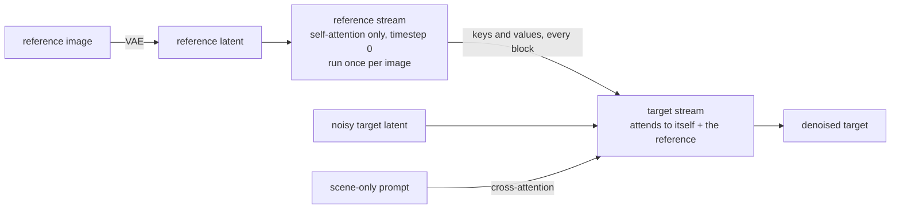
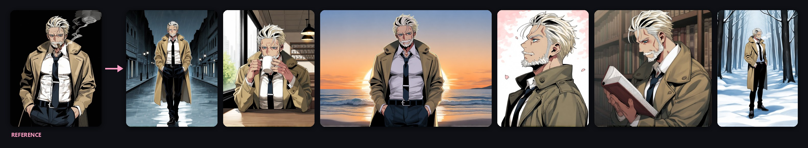
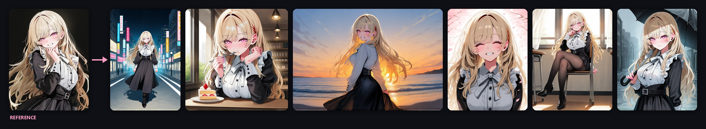
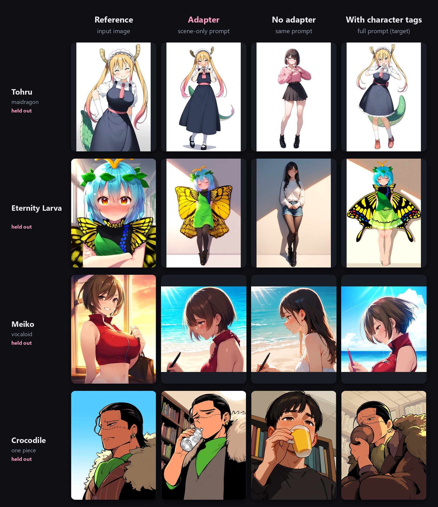

<div align="center">


# Anima Reference Adapter for ComfyUI

**Character and style from a reference image. Pose, place and framing from your prompt.**

[](https://huggingface.co/ElectronGirl/anima-ref-adapter)
[](https://github.com/ArcAnima/ComfyUI-Anima-Ref-Adapter)
[](https://github.com/ElectronGirl/anima-ref-adapter-research)
[](https://github.com/ArcAnima/ComfyUI-Anima-Ref-Adapter/blob/main/LICENSE)
[](https://huggingface.co/ElectronGirl/anima-ref-adapter/blob/main/LICENSE.md)

[Showcase](#showcase) · [Quick start](#quick-start) · [Guide](docs/guide.en.md) · [Speed](#speed-and-compatibility) · [Nodes](#nodes) · [How it works](#how-it-works) · [Training code](https://github.com/ElectronGirl/anima-ref-adapter-research)

**English** · [한국어](README.ko.md) · [日本語](README.ja.md)

</div>

<br>

Give [Anima](https://huggingface.co/circlestone-labs/Anima) one reference image and a prompt that describes
only the scene. The adapter keeps **who** is drawn (hair, eyes, outfit, accessories) and much of **how** it is
drawn; **pose, background and composition follow the prompt**. No character name, artist tag or outfit tags,
so it works for original characters too. Two references side by side give two characters in one image.

> [!NOTE]
> **Development is paused for lack of funding.** Further training is not possible for now, and the planned
> separate character and style references are not released. The training code, data generation and
> experiment log are public in **[anima-ref-adapter-research](https://github.com/ElectronGirl/anima-ref-adapter-research)**.

## What's new in v2

| | |
|---|---|
| ⚡ **About 2x faster than the pilot** | 2.1x per sampling step on an RTX PRO 6000. On an RTX 3060 Ti an 832x1216 image takes 65 s instead of 105 s: the reference adds 32 s instead of 72 s. The reference is encoded once per image instead of at every step. |
| 🧩 **One node** | **Anima Ref Adapter** drops into the standard Anima workflow and works with KSampler and any other sampler. The weights download on first use. |
| 👥 **Two characters** | Two references side by side, and a prompt that says who is on which side. |
| 📚 **More training data** | 15,600 images of 2,300 characters in 1,952 artist styles (pilot: 3,600 images, 300 characters), rank 64. |

## Showcase

The [one-node workflow](workflows/anima_ref_adapter.json) with Anima's default settings: er_sde, 30 steps, cfg 4.5,
`ref_guidance` 4.5 with APG, prompt `masterpiece, best quality, score_7, safe, 1girl, solo, <scene>` and the negative prompt from the Anima
model card. No other LoRAs. One seed per image, not cherry-picked, except the lying pose (the best of six).

### One reference


<sub><code>cowboy shot, sitting, cafe, holding cup, coffee, smile, looking at viewer, indoors, window, day</code> &nbsp;·&nbsp; <code>full body, lying, on side, on bed, head rest, looking at viewer, smile, bedroom, indoors, night, lamp light</code></sub>


<sub><code>full body, flying, from below, sky, clouds, sunlight, dynamic pose, outstretched arm</code> &nbsp;·&nbsp; <code>sitting, on floor, hugging own legs, sleepy, hangar, indoors, dim lighting</code></sub>


<sub><code>cowboy shot, beach, ocean, sunset, wind, hand on own hat, sun hat, smile, looking back</code> &nbsp;·&nbsp; <code>upper body, sitting, poolside, legs in water, splashing, laughing, day</code></sub>

### Two characters

Put the two references side by side in one image (the core **Image Stitch** node), write who is on the left
and who is on the right with a few words each, use `2girls` or `1boy, 1girl` instead of `solo`, and a
landscape size. [Workflow](workflows/anima_ref_adapter_two_characters.json).


<sub><code>2girls, the girl on the left is a policewoman with black hair over one eye, the girl on the right is a mecha girl with aqua hair and mechanical wings, standing side by side, peace sign, smile, city, street, day</code></sub>


<sub><code>2girls, the girl on the left is a policewoman with black hair over one eye, the girl on the right is a girl with short black hair in a blue frilled bikini, sitting together on a bench, eating ice cream, park, day</code></sub>


<sub><code>2girls, the girl on the left is a mecha girl with aqua hair and mechanical wings, the girl on the right is a girl with short black hair in a blue frilled bikini, high five, beach, ocean, day</code></sub>

## Quick start

```bash
cd ComfyUI/custom_nodes
git clone https://github.com/ArcAnima/ComfyUI-Anima-Ref-Adapter.git
```

1. Get Anima base v1.0, the Qwen3-0.6B text encoder and the Qwen-Image VAE from
   [circlestone-labs/Anima](https://huggingface.co/circlestone-labs/Anima), as for Anima itself.
2. Restart ComfyUI and open [`workflows/anima_ref_adapter.json`](workflows/anima_ref_adapter.json): the Anima
   text-to-image workflow plus one node. No other custom nodes are needed.
3. Load a reference image, write a prompt that describes only the scene, and queue. The first run downloads
   `anima_ref_adapter_v2_r64.safetensors` (183 MB) from [Hugging Face](https://huggingface.co/ElectronGirl/anima-ref-adapter) into `ComfyUI/models/loras/`; to install it by hand,
   [download it](https://huggingface.co/ElectronGirl/anima-ref-adapter/blob/main/anima_ref_adapter_v2_r64.safetensors) into that folder.

**In your own workflow:** put **Anima Ref Adapter** between the model (after any other LoRAs) and the
sampler, and connect the VAE and the reference image.

Step by step, with prompt tips and troubleshooting: **[user guide](docs/guide.en.md)**.

## Speed and compatibility

RTX 3060 Ti 8 GB (fp16), 832x1216, one reference; the faster of two runs:

| setup | time per image |
|---|---|
| Anima base, er_sde 30 steps, cfg 4.5, **no reference** | 33 s |
| + pilot adapter, `ref_guidance` 4.5 | 105 s |
| **+ v2 adapter**, `ref_guidance` 4.5 | **65-67 s** |
| `ref_guidance` 1 (no extra model call) | 50 s |
| + SageAttention ([KJNodes](https://github.com/kijai/ComfyUI-KJNodes) Patch Sage Attention) | 62 s |
| + EasyCache (core) | 63 s |
| `ref_end` 0.6 | 62 s |
| **turbo LoRA** (strength 1), 10 steps, cfg 1, `ref_guidance` 1 | **11 s** |


- SageAttention, EasyCache and `ref_end` 0.6 each save about 7% on this GPU, with nearly the same image.
- A **turbo LoRA** for Anima base (tested: `anima-turbo-lora-v0.2`) goes in front of the adapter. It keeps
  the characters but pulls the drawing toward its own look, so less of the reference style comes through.

<details>
<summary>The whole showcase with the turbo LoRA (10 steps, cfg 1)</summary>


</details>

Not tested: the Anima-Turbo and Anima-Aesthetic full models, SamplerSPEED, torch.compile.

## Nodes

| node | |
|---|---|
| **Anima Ref Adapter** | The one to use. `MODEL` + `VAE` + reference `IMAGE` + adapter LoRA -> `MODEL` for any sampler. The released adapter files are listed before they are downloaded and fetched on first use. The reference is resized to `ref_megapixels` (1.0) with its aspect ratio. `ref_guidance` runs as a post-CFG patch, one extra model call per step when it is not 1; `ref_end` stops that call early. |
| Anima Ref Adapter Loader, Anima Ref Latent, Anima Ref Guider | The separate nodes, for the pilot adapter (it needs the reference at the output size) and the guider options `ref_start` and `outside`. [Workflow](workflows/anima_ref_adapter_advanced.json). |

## Recommended settings

| | recommended | notes |
|---|---|---|
| base model | Anima base v1.0 | the adapter was trained on it; a turbo LoRA also works |
| sampler | any; er_sde or Euler, 30 steps, `simple` | as for Anima without the adapter |
| `cfg` | 4.5 | text guidance; 1 with a turbo LoRA |
| `ref_guidance` | 4.5 | 1 = cheaper and weaker; higher = more character detail and style, more saturation |
| `correction` | `apg` | or `rescale` (phi 0.5) |
| `ref_end` | 1.0 | ~0.6 is faster with nearly the same image |
| prompt | quality + `1girl` / `1boy` + `solo` + scene tags | no character name, artist tag or outfit tags; a few appearance tags are fine |
| other LoRAs | in front of the adapter node | |

## How it works



- **Asymmetric attention.** Target tokens attend to themselves and the reference; reference tokens attend
  only to themselves and skip the text cross-attention. The reference therefore depends on nothing that
  changes during sampling, so its keys and values are computed once per image and reused by every step and
  both CFG branches. It may have any size.
- The reference sits at **shifted RoPE coordinates**, past the target grid, so it is read as appearance and
  not copied pixel-aligned (no pose copying).
- A **rank-64 LoRA**, active only with the reference, learns to read it. Training pairs are the same character
  in different scenes, generated by Anima, with the character's name, artist and appearance tags removed
  from the target prompt.
- **Separate text and reference guidance**, with adaptive projected guidance (APG) against over-saturation.

| 832x1216, RTX PRO 6000, CFG | pilot (two-frame) | v2 (asymmetric) | no reference |
|---|---|---|---|
| one sampling step | 0.58 s | 0.28 s (+ 0.1 s once to encode the reference) | 0.24 s |

The pilot instead appended the reference as a second latent frame and recomputed it at every step. Its
method, data and failure modes: **[technical report](docs/report.md)**.

## Pilot (v1)

The pilot (`anima_ref_adapter_pilot_r32.safetensors`, rank 32) stays available and works with the
[advanced workflow](workflows/anima_ref_adapter_advanced.json).

<details>
<summary>Pilot gallery and held-out characters</summary>

Prompt `masterpiece, best quality, score_7, newest, highres, absurdres, safe, <gender>, solo, <scene>`;
Euler 28 steps, cfg 4.5, reference guidance 4.5 + APG, context detailer LoRA 0.3, base slider LoRA 0.6,
Anima Safe PAG. Not cherry-picked.


<sub><code>full body, walking, hands in pockets, city, street, night, rain</code> &nbsp;·&nbsp; <code>upper body, sitting, holding cup, drinking, cafe, indoors, window, sunlight</code> &nbsp;·&nbsp; <code>cowboy shot, looking at viewer, smile, beach, ocean, sunset</code> &nbsp;·&nbsp; <code>portrait, from side, looking afar, cherry blossoms, petals</code> &nbsp;·&nbsp; <code>upper body, reading, holding book, library, bookshelf</code> &nbsp;·&nbsp; <code>full body, standing, snow, forest, winter</code></sub>


<sub><code>full body, walking, smile, city, street, night, neon lights</code> &nbsp;·&nbsp; <code>upper body, sitting, eating, cake, cafe, indoors</code> &nbsp;·&nbsp; <code>cowboy shot, looking back, smile, beach, ocean, sunset</code> &nbsp;·&nbsp; <code>portrait, closed eyes, smile, cherry blossoms, petals, wind</code> &nbsp;·&nbsp; <code>full body, sitting, on chair, crossed legs, classroom, sunlight</code> &nbsp;·&nbsp; <code>upper body, holding umbrella, rain, street, looking at viewer</code></sub>

**Held-out characters**, excluded from training. Each row: the reference, the adapter's result for a new
scene, the same scene-only prompt without the adapter, and the base model with the character named and its
appearance tags.



| character | scene tags |
|---|---|
| Tohru | `full body, looking at viewer, heart hands, crying, simple background, white background` |
| Eternity Larva | `full body, looking at viewer, against wall, closed eyes, gradient background, sunlight` |
| Meiko | `portrait, from side, writing, crying, beach, ocean, light rays` |
| Crocodile | `upper body, from below, drinking, sad, bookshelf, indoors` |

</details>

## Limitations

- Identity transfers much better than style; strongly painterly styles barely transfer.
- Small patterns, scars, earrings and unusual skin tones are often lost; large garments can drift in color.
- The reference character occasionally reappears as an object in the scene.
- Trained only on images generated by Anima; it inherits the base model's biases.

## Roadmap

| | status |
|---|---|
| Single reference: character and style from one image | ✅ pilot, v2 |
| Asymmetric attention with a cached reference | ✅ v2 |
| Two characters from two references side by side | ✅ v2 |
| Separate character and style references | ⏸️ paused (experiments only) |
| Higher-resolution training, better painterly styles and fine details | ⏸️ paused |

## License

The node code is **Apache-2.0** ([LICENSE](LICENSE)). The adapter weights are a derivative of the
CircleStone Model and are distributed on Hugging Face under the **CircleStone Non-Commercial License**.
This project is not affiliated with or endorsed by CircleStone Labs.

## Citation

```bibtex
@misc{anima_ref_adapter_2026,
  title  = {Anima Reference Adapter: Single-Image Character and Style Transfer with an Offset-RoPE Reference Frame},
  author = {ElectronGirl},
  year   = {2026},
  url    = {https://github.com/ArcAnima/ComfyUI-Anima-Ref-Adapter}
}
```
