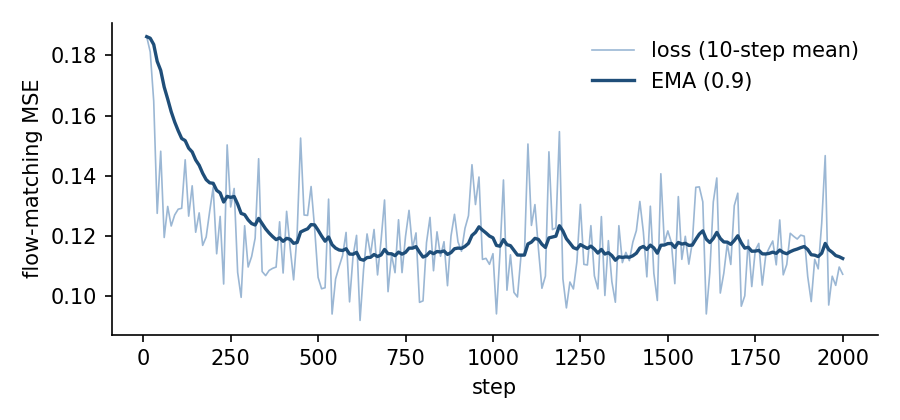
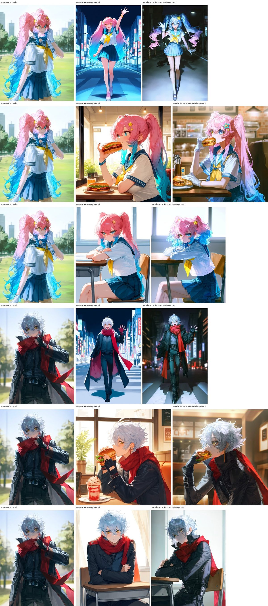
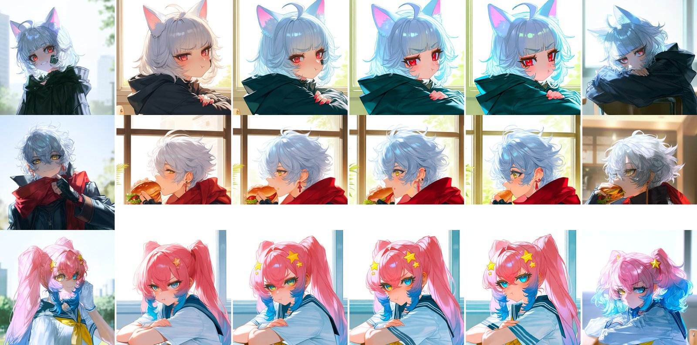
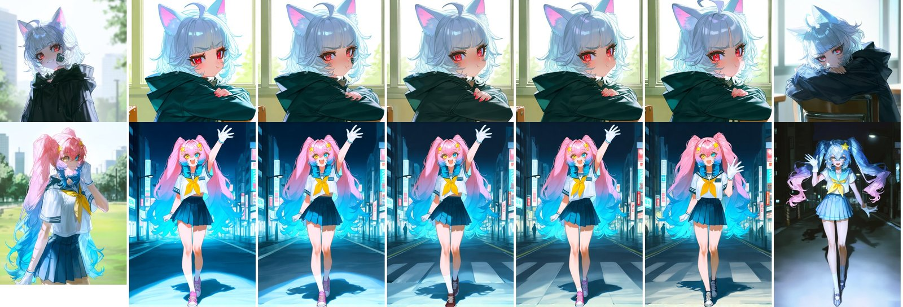
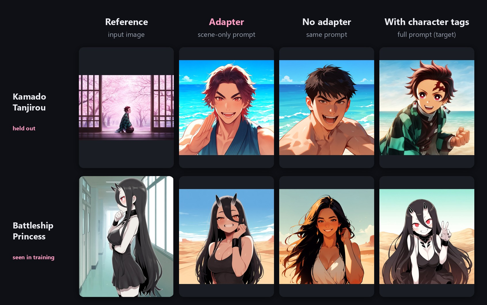

# Anima Reference Adapter: Single-Image Character and Style Transfer with an Offset-RoPE Reference Frame

**ElectronGirl** · October 2026 · Technical report (pilot release)

Weights: [ElectronGirl/anima-ref-adapter](https://huggingface.co/ElectronGirl/anima-ref-adapter) · Code: [ArcAnima/ComfyUI-Anima-Ref-Adapter](https://github.com/ArcAnima/ComfyUI-Anima-Ref-Adapter)

## Abstract

We present a lightweight reference adapter for Anima, a 2B-parameter anime text-to-image diffusion
transformer built on Cosmos-Predict2. Given one reference image, the adapter reproduces the depicted
character and, to a lesser degree, its drawing style in a new scene described by a prompt that contains
neither a character name nor artist or appearance tags. The reference is appended as a second latent
frame on the time axis, fed clean (timestep 0), and its rotary position coordinates are shifted past the
target grid, so the model cannot reuse its video prior to copy the reference pixel by pixel. A rank-32
LoRA (45.9M parameters), active only while a reference is attached, learns to read this frame. Training
pairs are synthesized with Anima itself: images of the same character in the same style but different
scenes, rendered with exact Danbooru appearance and outfit tags so that the identity stays fixed within
a group. A pilot trained on 3,600 generated images (300 characters) for 2,000 steps transfers
hairstyle, colors, outfits and accessories to held-out characters and to original characters drawn
in an artist style unseen in training, while pose and background follow the prompt. We also describe
separate text and reference guidance with an adaptive projection that limits over-saturation, and
document failure modes. This is a pilot release; a larger dataset is being generated.

## 1. Introduction

Text-to-image anime models are usually steered towards a character or an artist with tags. That works
only for characters and artists the model already knows, and the prompt must spell out every visual
trait. Reference-based conditioning (IP-Adapter [1], in-context editing models such as FLUX.1 Kontext
[2], OminiControl [3]) instead takes the identity from an image.

Anima uses the Cosmos-Predict2 MiniTrainDIT [4], a video-capable DiT with 3D rotary position embeddings
over (t, h, w). ComfyUI-Cosmos-Reference exploits this by appending a reference latent as an extra frame.
Without training this works surprisingly well for editing, but it also copies the reference's pose and
layout: with aligned (h, w) coordinates in consecutive frames, the video prior reads the reference as
the previous frame of the same shot.

Our goal is the opposite trade-off: keep **who** (identity, outfit) and **how it is drawn** (style),
discard **where and in which pose**. We make three changes:

1. **Clean reference frame.** The reference frame receives timestep 0, the target frame receives σ.
2. **Offset RoPE.** The reference frame's h coordinates are shifted by one target height (plus training
   jitter). Spatial correspondence no longer exists, so the model must use the reference as a source of
   appearance rather than as a layout to continue.
3. **LoRA trained on synthetic pairs** in which the target prompt omits everything the reference
   should provide.

## 2. Method

### 2.1 Architecture

Anima: Cosmos-Predict2 MiniTrainDIT, 28 blocks, width 2048, 16 heads, 2×2 spatial patches over a
16-channel Wan 2.1 VAE latent (8× downsampling), Qwen3-0.6B text encoder with an LLM adapter producing
the cross-attention context. Flow matching with shift 3.

For a target latent x_t ∈ R^{16×1×H×W} and a reference latent r (the reference image letterboxed to
the output size with white padding and VAE-encoded), the DiT input is the two-frame clip [x_t, r]:

| | target frame | reference frame |
|---|---|---|
| timestep | σ | 0 |
| RoPE t | 0 | 1 |
| RoPE h | 0 … H_p−1 | H_p + δ … 2H_p − 1 + δ |
| RoPE w | 0 … W_p−1 | 0 … W_p−1 |

H_p, W_p are the patch-grid sizes; δ ~ U{0, …, 8} during training and δ = 0 at inference. All tokens
attend to each other through self-attention; the output for the reference frame is discarded. The
per-frame timestep uses the model's existing (B, T) timestep path, so no new parameters are needed
for it.

**LoRA.** Rank 32, α = 32, on every block's self-attention and cross-attention projections
(q, k, v, out) and both MLP layers: 280 modules, 45.9M trainable parameters. The base model, text
encoder and VAE are frozen. At inference the LoRA is applied through forward hooks and only during
model calls that carry a reference, so the same loaded base model can also produce a reference-free
branch (Sec. 2.3).

### 2.2 Training objective

Rectified-flow matching on the target frame only:

  x_t = (1 − σ) x_0 + σ ε,  loss = ‖ v_θ([x_t, r], σ, c) − (ε − x_0) ‖²

with σ drawn by applying Anima's shift-3 map to u ~ U(0, 1) (σ = 3u / (1 + 2u)), i.e. the inference
schedule's time distribution.

### 2.3 Guidance

With the reference in both CFG branches (standard CFG on the adapted model), only the text is amplified.
We use separate text and reference scales in the spirit of InstructPix2Pix [5]:

  x̂ = D(∅) + s_r · (D(r, ∅) − D(∅)) + s_t · (D(r, c) − D(r, ∅))

where D(·) is the denoised prediction, ∅ the negative prompt, c the positive prompt, and D(∅) the base
model without reference or LoRA. s_r = 1 recovers plain CFG with the reference in both branches;
s_r = s_t removes the reference from the unconditional branch. High s_r over-saturates, so the
combined update relative to D(r, c) is corrected either with CFG rescale [6] (match the standard
deviation of D(r, c), blend with φ) or with adaptive projected guidance (APG) [7] (drop the component of
the update parallel to D(r, c)).

## 3. Data

All training images are generated by Anima base v1.0. No scraped images are used for training.

**Characters.** Danbooru characters with ≥1,000 posts from a 2026 wiki dump (kierarkia/danbooru-wiki-2026).
For each, appearance and outfit tags are mined from single-character posts in
trojblue/danbooru2025-metadata (9.1M posts): appearance tags (hair, eyes, anatomy, species) appearing in
≥40% of the character's posts (at most 8), outfit tags in ≥30% (at most 10), gender if ≥60%. Tags are
classified with the Mexes/danbooru-tag-taxonomy (CC BY 4.0) and written in exact Danbooru spelling.
Without these tags Anima drew the same character inconsistently across seeds; with them, identity
is stable within a group.

**Styles.** Artists with ≥300 posts; a style is one artist (50%), or a weighted mix of two (35%) or
three (15%).

**Groups.** A group is one (character, style) pair rendered 6 times, each with an independently sampled
framing, camera angle, pose, expression, background and lighting (Danbooru tags validated against the
taxonomy) and one of four ~1 MP resolutions. Characters and styles are each used in two groups.
Prompt: quality tags, rating (`safe`), artists, gender, `solo`, character, copyright, appearance,
outfit, scene; the usual negative quality tags.

**Pilot set.** 600 groups, 3,600 images, 300 characters, 427 artists; generated in 4.25 h on one
RTX PRO 6000 Blackwell Max-Q (bf16, SageAttention 2, SamplerSPEED with an Euler base, 24 steps,
CFG 4.5). Twelve characters, chosen by hash, are
held out entirely; 576 groups remain for training.

**Pairs.** Every ordered pair (reference, target) of distinct images in a training group: 17,280 pairs.
The target prompt is reduced so that the reference must carry identity and style:

| variant | share | prompt |
|---|---|---|
| scene only | 70% | quality, rating, gender, `solo`, scene tags |
| partial | 20% | + a random 30–70% of the appearance/outfit tags |
| minimal | 10% | quality, rating, gender, `solo` |

Character names, copyright and artist tags are never in a target prompt. The reference is letterboxed
to the target resolution and VAE-encoded once (10,866 reference latents).

## 4. Training

| setting | value |
|---|---|
| steps / batch | 2,000 / 4 (same-resolution buckets) |
| optimizer | AdamW, lr 1e-4, 100 warm-up steps, cosine to 1e-5, no weight decay, grad-norm clip 1.0 |
| precision | bf16 base weights and activations, fp32 LoRA weights |
| memory | gradient checkpointing on the first 16 of 28 blocks; 47.6 GB peak |
| hardware / time | 1× RTX PRO 6000 Max-Q, 4.1 s/step, 2.4 h |

The training forward re-uses ComfyUI's Anima modules. Before training, a self-test checks that our
two-frame forward with no reference reproduces ComfyUI's own forward (maximum absolute difference 0.0),
so the trained LoRA plugs back into ComfyUI unchanged.

*Figure 1. Training loss (flow-matching MSE, 10-step means and EMA).*

## 5. Results

All samples use Euler, 30 steps, text CFG 4.5. Evaluation is qualitative; we have not yet computed
identity or style similarity metrics.

### 5.1 Held-out characters

*Figure 2. Held-out characters (never seen in training). Columns: reference; adapter with a scene-only
prompt; the same prompt without the adapter; the generator's image with full character tags.
Reference guidance 1 (reference in both CFG branches).*

For most held-out characters the adapter reproduces hair color and style, eye color, outfit and
signature accessories (horns and tail, halo, butterfly wings, maid headdress), while the prompt alone
yields a generic character. Pose, framing and background follow the prompt in all 18 evaluation cases;
we did not observe pose copying.

### 5.2 Original characters in an unseen artist style

*Figure 3. References are original characters described only by appearance tags and drawn by the base
model with an artist tag that is not in the training set. Columns: reference; adapter (scene-only
prompt); base model with artist + description tags.*

Character design transfers well (gradient twintails, star hair ornaments, neckerchief; silver hair,
red scarf, gloves). The artist's painterly rendering, soft lighting and muted palette do not transfer at
reference guidance 1: outputs fall back to a crisper default Anima look.

### 5.3 Reference guidance

*Figure 4. Crops at reference guidance s_r = 1, 2.5, 4.5, 6 (left to right after the reference; last
column: base model with full tags).*

Raising s_r moves the result towards the reference: hair texture and highlights, eye rendering, the
cool palette, small accessories (bandage, gloves, heterochromia) that s_r = 1 dropped. The painterly
rendering still does not appear, which suggests the LoRA has learned little of it rather than that it is
under-amplified. Above ~4.5 colors over-saturate and a color drift present at s_r = 1 (a black hoodie
drawn dark green) is amplified.

*Figure 5. s_r = 4.5 without correction, CFG rescale φ = 0.5 and 0.7, APG; APG at s_r = 6; base model with
full tags.*

Both corrections reduce saturation while keeping the reference traits; APG allows s_r = 6 with less
saturation than uncorrected s_r = 4.5. We use s_r = 4.5–6 with APG as the default.

### 5.4 Failure modes

*Figure 6. Failure cases.*

- **Fine details:** small patterns (a checkered haori), scars, earrings and unusual skin tones (pale or
  grey skin) are often lost.
- **Reference duplication:** occasionally the reference character reappears as an object in the scene
  (e.g. a plush toy of the character).
- **Color drift** of large garments, amplified by high reference guidance.
- **Multi-resolution samplers.** SamplerSPEED renders early steps at half resolution. Shrinking the
  reference latent to match produces off-manifold latents and broken images at high s_r. Encoding a
  separate half-resolution reference through the VAE removes the artifacts, but compositions remain
  unreliable because the adapter never saw half-resolution pairs. We recommend single-resolution
  samplers for now.

## 6. Limitations

- Pilot scale: 300 training characters, 2,000 steps, rank 32.
- Style transfer is weak for strongly painterly styles; identity transfer is much stronger than style
  transfer.
- No quantitative evaluation yet.
- All training data is synthetic; the adapter inherits Anima's biases and failure modes.
- Weights are a derivative of Anima and are distributed under the CircleStone Non-Commercial License.

## 7. Ongoing work

- **Character × style grid.** A 12,000-image set is being generated: 2,000 new characters, each drawn in
  3 styles, each style used for 3 characters, 2 scenes per cell, 70% single-artist styles. It yields
  same-character/different-style and same-style/different-character pairs for an adapter with separate
  character and style reference slots.
- **Low-noise weighting.** Style and texture are decided late in sampling; the current σ distribution
  concentrates training at high noise.
- **Half-resolution pairs** for compatibility with progressive samplers.
- **Metrics** for identity and style similarity on held-out characters and artists.

## 8. Usage and licensing

The ComfyUI nodes (Apache-2.0) are in this repository; the LoRA is on Hugging Face under the
CircleStone Non-Commercial License. This is an independent project and is not affiliated with or
endorsed by CircleStone Labs. Artist names are used as generation tags only; please respect artists
and do not use the adapter to pass off imitations as their work.

**Attribution notice.** The CircleStone Model is licensed by CircleStone Labs LLC under the CircleStone
Non-Commercial License. Copyright CircleStone Labs LLC. IN NO EVENT SHALL CIRCLESTONE LABS LLC BE LIABLE
FOR ANY CLAIM, DAMAGES OR OTHER LIABILITY, WHETHER IN AN ACTION OF CONTRACT, TORT OR OTHERWISE, ARISING
FROM, OUT OF OR IN CONNECTION WITH USE OF THIS MODEL. The adapter weights are a modified derivative of
the CircleStone Model (Anima base v1.0).

## Acknowledgements

Anima (CircleStone Labs); ComfyUI; ComfyUI-Cosmos-Reference for the temporal reference idea;
kierarkia/danbooru-wiki-2026, trojblue/danbooru2025-metadata (MIT) and Mexes/danbooru-tag-taxonomy
(CC BY 4.0) for tag statistics; SageAttention [8] and ComfyUI-SPEED for generation speed;
comfyui-anima-safe-pag for perturbed-attention guidance [9].

## References

1. H. Ye et al. IP-Adapter: Text Compatible Image Prompt Adapter for Text-to-Image Diffusion Models. 2023.
2. Black Forest Labs. FLUX.1 Kontext: Flow Matching for In-Context Image Generation and Editing in Latent Space. 2025.
3. Z. Tan et al. OminiControl: Minimal and Universal Control for Diffusion Transformer. 2024.
4. NVIDIA. Cosmos World Foundation Model Platform for Physical AI (Cosmos-Predict2). 2025.
5. T. Brooks, A. Holynski, A. Efros. InstructPix2Pix: Learning to Follow Image Editing Instructions. CVPR 2023.
6. S. Lin et al. Common Diffusion Noise Schedules and Sample Steps are Flawed. WACV 2024.
7. S. Sadat, O. Hilliges, R. Weber. Eliminating Oversaturation and Artifacts of High Guidance Scales in Diffusion Models. ICLR 2025.
8. J. Zhang et al. SageAttention2: Efficient Attention with Thorough Outlier Smoothing and Per-thread INT4 Quantization. 2024.
9. D. Ahn et al. Self-Rectifying Diffusion Sampling with Perturbed-Attention Guidance. ECCV 2024.
10. E. Hu et al. LoRA: Low-Rank Adaptation of Large Language Models. ICLR 2022.
11. X. Liu, C. Gong, Q. Liu. Flow Straight and Fast: Learning to Generate and Transfer Data with Rectified Flow. ICLR 2023.
